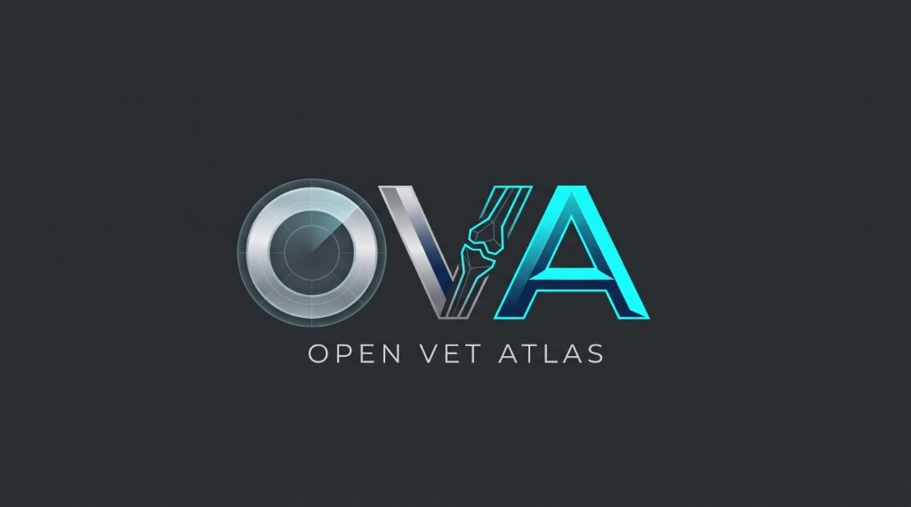
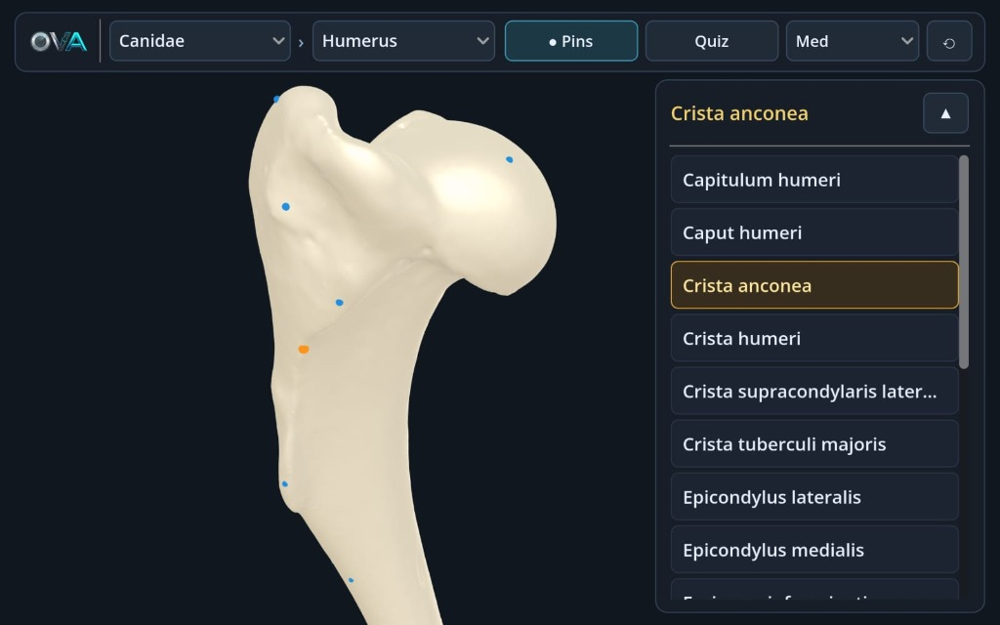
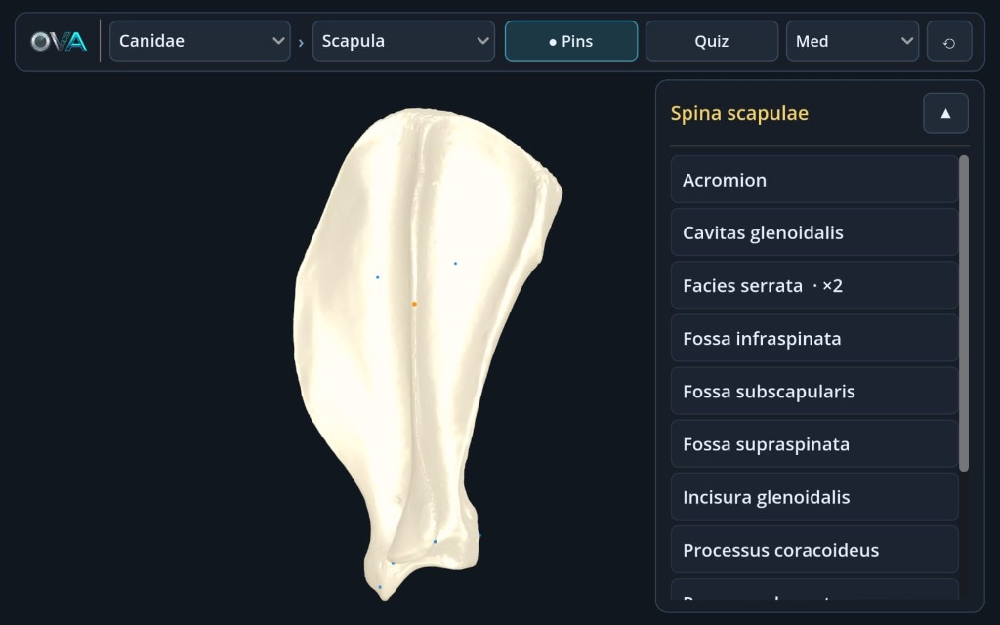
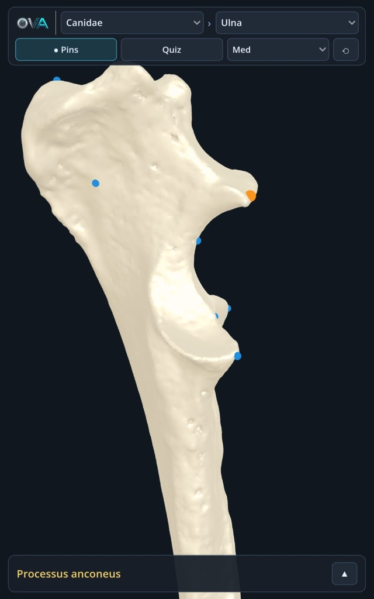
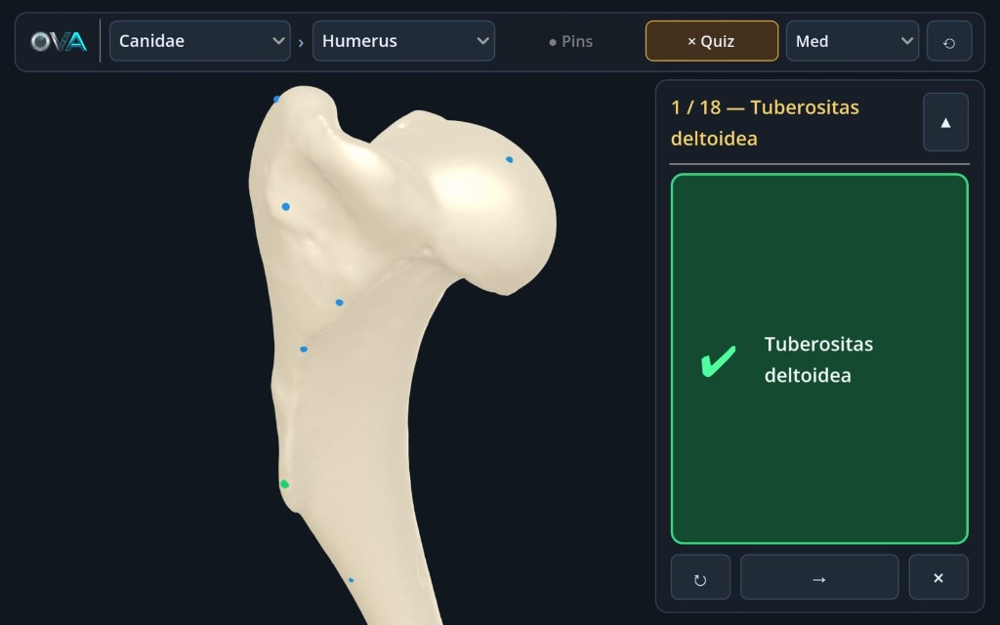
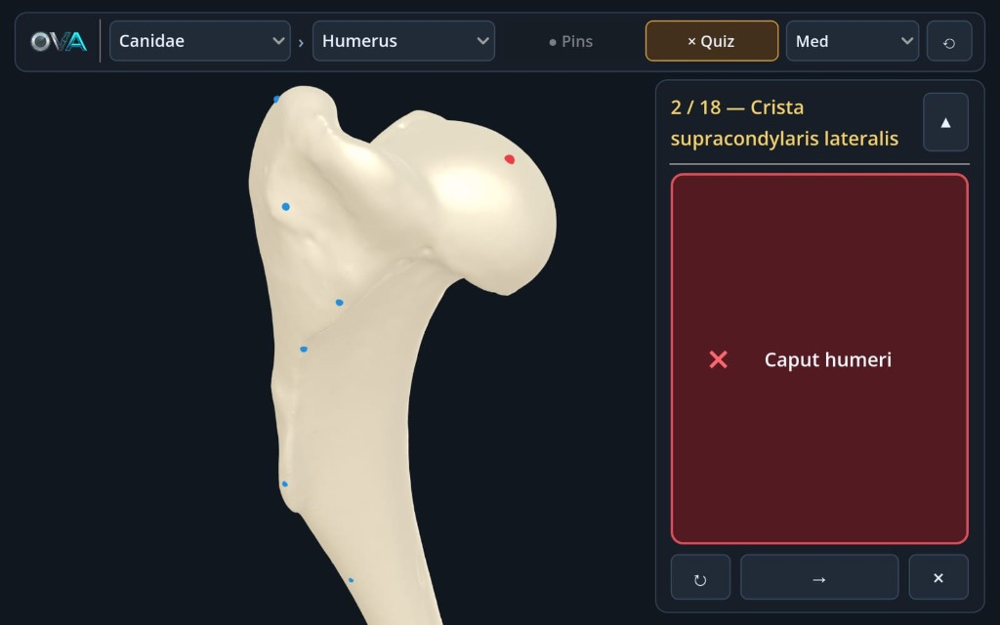

<p align="center">
  
</p>

<h1 align="center">OpenVetAtlas Android (oVa)</h1>

<p align="center">
  <b>Open-Source 3D Veterinary Anatomy & Osteology Platform for Android Phones and Tablets (Godot Engine / GLES3)</b><br/>
  <i>Android Telefon ve Tabletler İçin Açık Kaynaklı 3B Veteriner Anatomi ve Osteoloji Platformu</i>
</p>

<p align="center">
  
  
  
  
</p>

---

## 📸 In-App Screenshots / Uygulama İçi Görseller

<p align="center">
  
  <br/>
  <i><b>3D Surface Anatomical Landmarks & Clinical List:</b> Interactive 3D surface spheres and pure Latin (Nomina Anatomica Veterinaria) terminology list on a canine humerus (Crista anconea selected and auto-centered).</i>
</p>

<table align="center">
  <tr>
    <td align="center" width="50%">
      <br/>
      <b>Canine Scapula & Paired Landmarks (<code>Facies serrata · ×2</code>)</b><br/>
      <i>Skapula İncelemesi ve Çift Noktalı Oluşum Gösterimi</i>
    </td>
    <td align="center" width="50%">
      <br/>
      <b>Adaptive Portrait Smartphone UI (<i>Canidae › Ulna</i>)</b><br/>
      <i>Telefon Dikey Mod Uyarlanabilir Üst Bar ve Küçültülebilir Çekmece</i>
    </td>
  </tr>
  <tr>
    <td align="center" width="50%">
      <br/>
      <b>Universal Latin Quiz Mode — Correct Selection (<code>✔</code>)</b><br/>
      <i>Evrensel Latince Quiz Modu — Doğru Nokta Seçimi (<code>✔</code>)</i>
    </td>
    <td align="center" width="50%">
      <br/>
      <b>Universal Latin Quiz Mode — Incorrect Selection (<code>×</code>)</b><br/>
      <i>Evrensel Latince Quiz Modu — Yanlış Nokta Geri Bildirimi (<code>×</code>)</i>
    </td>
  </tr>
</table>

---

## 🌐 English

**Open-Source 3D Veterinary Anatomy and Osteology Platform for Android Phones & Tablets (Godot 4 / GL Compatibility)**

OpenVetAtlas Android (oVa) is a free, open-source mobile 3D anatomy platform designed to make high-precision veterinary osteology accessible to every student—running smoothly on both 7–8 year old entry-level ("potato") Android phones/tablets and modern flagship devices.

The development process of this project utilized the **DijiLab** infrastructure, which was established by the **Department of Veterinary Anatomy, Faculty of Veterinary Medicine** at **Aydın Adnan Menderes University (ADÜ)** and supported by **ADÜ-BAP**.

### ✨ Features
* **High-Precision 3D Digital Twins:** Accurate 3D osteological specimens scanned from real anatomical bones (*Canidae: Scapula, Humerus, Radius, Ulna* and *Equidae: Cranium* with photogrammetry albedo texture).
* **"Potato-to-Flagship" Accessibility (`gl_compatibility` & MatCap):** Uses OpenGL ES 3.0 (`gl_compatibility`) to prevent Vulkan driver crashes on older budget devices, paired with a hybrid **MatCap + Albedo shader** and runtime **Quality Tiers (`Low / Med / High`)** (`QualityManager`).
* **On-Demand Rendering (Zero Battery Drain):** Built with `OS.low_processor_usage_mode = true`. When the student is reading anatomical terms without touching the screen, viewport rendering pauses automatically—consuming near 0% GPU and preventing device overheating.
* **Pure Latin (NAV) Standard & 3D Surface Spheres:** Uses universal *Nomina Anatomica Veterinaria* (NAV) Latin terminology without cluttering 2D screen badges. Clicking any anatomical term in the menu smoothly rotates, centers, and zooms the bone to bring that 3D landmark directly in front of the user.
* **Pin Visibility Toggle (`● Pins / ○ Pins`):** Toggle 3D landmark spheres on or off at any time to inspect subtle bone grooves (*sulcus*), foramina, and fossae unobstructed.
* **Universal Interactive Quiz Mode (`✔` / `×`):** Prompts the user with a target Latin anatomical term and evaluates 3D point taps with language-independent emerald (`✔`) or crimson (`×`) feedback cards. Users can exit Quiz mode at any time or complete all landmarks on the specimen.
* **Fit-to-Screen Adaptive Mobile & Tablet UI:** Automatically detects physical screen size (Phone vs. Tablet) and orientation (Portrait vs. Landscape), scaling UI controls to fit 100% within safe screen bounds (`DisplayServer.get_display_safe_area()`) with a collapsible drawer in both orientations.

### 📱 Touch & Desktop Controls

| Gesture / Control | Function |
| :--- | :--- |
| **1-Finger Drag** *(or Left Mouse Drag)* | Orbit camera 360° around the bone center (`TouchOrbitCamera`) |
| **2-Finger Pinch** *(or Mouse Wheel)* | Zoom in / out smoothly (with frame-coalesced jitter filtering) |
| **2-Finger Drag** *(or Right Mouse Drag)* | Pan camera target pivot |
| **Quick Tap on 3D Sphere (`< 220 ms`)** | Select anatomical landmark on the bone (or answer in Quiz Mode) |
| **Tap Term in Menu List** | Highlight 3D landmark and automatically rotate/center the bone to face it |
| **`● Pins` / `○ Pins` Button** | Show or hide all 3D anatomical surface spheres |
| **`Quiz` / `× Quiz` Button** | Start or exit interactive Latin Quiz Mode at any time |
| **`▲` / `▼` Drawer Button** | Collapse or expand the anatomical terms panel (Portrait & Landscape) |
| **`⟲` Button** | Reset camera orbit, pan, and zoom to default AABB framing |

### 🛠️ Setup, Headless Verification & APK Build
1. Open the project in **Godot Engine 4.3+** (tested with `Godot 4.7.2-stable`).
2. Import all read-only `.fbx` models and run the automated headless verification suite:
   ```bash
   godot --headless --import
   godot --headless -s res://scripts/verify_main_atlas.gd
   ```
3. Export a signed Android APK via the Godot Editor (**`Project -> Export -> Android`**) or command line:
   ```bash
   godot --headless --export-debug "Android" "OpenVetAtlas_v0.4.0.apk"
   ```

### 📜 License and Copyright (IMPORTANT)
The software architecture, GDScript source code, shaders, and UI systems of this project are licensed as open-source under the **GNU Affero General Public License v3.0 (AGPL-3.0)**.

**However;** **all 3D anatomical models (`.fbx`, `.obj`, etc.) and textures (`.png`)** included in the project were produced within **DijiLab** and are protected under the **Creative Commons Attribution-NonCommercial-ShareAlike 4.0 (CC BY-NC-SA 4.0)** license. These 3D models can in no way be **used for commercial purposes, sold, or integrated into a closed-source commercial product.**

---
*Developers:* Eren Özgürcan Yavaş, Fatih Gürler

---

## 🇹🇷 Türkçe

**Android Telefon ve Tabletler İçin Açık Kaynaklı 3B Veteriner Anatomi ve Osteoloji Platformu (Godot 4 / GL Compatibility)**

OpenVetAtlas Android (oVa), veteriner hekimliği eğitiminde üç boyutlu osteoloji öğrenimini her öğrenci için erişilebilir kılmak amacıyla geliştirilmiş; hem 7–8 yıllık giriş seviyesi Android telefon ve tabletlerde hem de güncel amiral gemisi cihazlarda akıcı çalışan açık kaynaklı bir mobil anatomi platformudur.

Bu projenin geliştirme sürecinde, **ADÜ-BAP** tarafından desteklenen ve **Aydın Adnan Menderes Üniversitesi Veteriner Fakültesi Anatomi Anabilim Dalı**'nca kurulan **DijiLab** altyapısı kullanılmıştır.

### ✨ Özellikler
* **Yüksek Hassasiyetli 3B Dijital İkizler:** Gerçek anatomik piyeslerden taranmış 3B dijital ikizler (*Canidae: Scapula, Humerus, Radius, Ulna* ve fotogrametri dokulu *Equidae: Cranium*).
* **Her Cihazda Akıcı Performans (`gl_compatibility` & MatCap):** Eski Android GPU'larda Vulkan çökmelerini önleyen OpenGL ES 3.0 tabanı, sıfıra yakın GPU maliyetli **MatCap + Albedo hibrit shader** ve çalışma zamanı **Kalite Katmanları (`Low / Med / High`)** (`QualityManager`).
* **Pil Dostu İhtiyaç Anında Çizim (`low_processor_usage_mode`):** Kullanıcı ekrana dokunmadığında veya kamera dönüşü tamamlandığında motor kare çizimini duraklatır; öğrenci anatomik terimleri incelerken GPU kullanımı ~%0 seviyesine iner ve cihaz ısınmaz.
* **Saf Latince (NAV) Standardı ve 3B Yüzey Küreleri:** Tüm terimler evrensel *Nomina Anatomica Veterinaria* (NAV) standardındadır. Menüdeki listeden herhangi bir anatomik oluşuma tıklandığında kemik otomatik olarak ortalanır, hafifçe uzaklaşır (zoom-out) ve seçilen 3B noktayı kullanıcının tam karşısına döndürür.
* **Noktaları Açıp Kapatma (`● Pins / ○ Pins`):** Kemik yüzeyindeki sulkus, foramen ve fossa yapılarını hiçbir işaretleyici olmadan incelemek için 3B küreleri tek dokunuşla gizleme/gösterme.
* **Evrensel Etkileşimli Quiz Modu (`✔` / `×`):** Hedef Latince terimi sorar; doğru 3B noktaya dokunulduğunda yeşil **`✔`**, yanlış noktaya dokunulduğunda tıklanan noktanın Latince adıyla birlikte kırmızı **`×`** geri bildirim kartı gösterir. Kullanıcı istediği an Quiz modundan çıkabilir veya tüm terimleri tamamlayabilir.
* **Fit-to-Screen Uyarlanabilir Telefon ve Tablet Arayüzü:** Cihazın telefon veya tablet olduğunu ve dikey/yatay konumunu algılayarak menü ölçeğini ekrana tam sığacak şekilde ayarlar; hem dikey hem yatay modda terim menüsü küçültülüp büyütülebilir.

### 📱 Dokunmatik Kontroller

| Hareket / Buton | İşlev |
| :--- | :--- |
| **Tek Parmak Sürükleme** | Kemiğin etrafında 360° kamera dönüşü (`TouchOrbitCamera`) |
| **İki Parmak Kıstırma (Pinch)** | Yakınlaştırma / uzaklaştırma (titreme filtreli) |
| **İki Parmak Sürükleme** | Kamerayı kaydırma (Pan) |
| **3B Küreye Hızlı Dokunuş (`< 220 ms`)** | Kemik üzerindeki anatomik oluşumu seçme (veya Quiz'de yanıtlama) |
| **Menü Listesinden Terime Tıklama** | 3B küreyi vurgulama ve kemiği döndürüp o noktayı ekran ortasına getirme |
| **`● Pins` / `○ Pins` Butonu** | Kemik üzerindeki 3B anatomik küreleri gösterme / gizleme |
| **`Quiz` / `× Quiz` Butonu** | Evrensel Latince Quiz modunu başlatma veya istediği an çıkma |
| **`▲` / `▼` Butonu** | Anatomik terimler menüsünü küçültme / büyütme (Dikey ve Yatay mod) |
| **`⟲` Butonu** | Kamera açısını ve yakınlaştırmayı başlangıç konumuna sıfırlama |

### 🛠️ Kurulum, Doğrulama ve APK Derleme
1. Projeyi **Godot Engine 4.3+** (`4.7.2-stable`) ile açın.
2. FBX modellerini içe aktarıp otomatik headless doğrulama testini çalıştırın:
   ```bash
   godot --headless --import
   godot --headless -s res://scripts/verify_main_atlas.gd
   ```
3. Android APK çıktısı almak için:
   ```bash
   godot --headless --export-debug "Android" "OpenVetAtlas_v0.4.0.apk"
   ```

### 📜 Lisans ve Telif Hakları (ÖNEMLİ)
Bu projenin yazılım mimarisi ve kaynak kodları **GNU Affero General Public License v3.0 (AGPL-3.0)** ile açık kaynak olarak lisanslanmıştır.

**Ancak;** proje içerisinde yer alan **tüm 3D anatomik modeller (`.fbx`, `.obj` vb.) ve kaplamalar (`.png` textures)** DijiLab bünyesinde üretilmiş olup, **Creative Commons Attribution-NonCommercial-ShareAlike 4.0 (CC BY-NC-SA 4.0)** lisansı ile korunmaktadır. Bu 3D modeller hiçbir şekilde **ticari amaçla kullanılamaz, satılamaz veya kapalı kaynaklı ticari bir ürüne entegre edilemez.**

---
*Geliştirici:* Eren Özgürcan Yavaş, Fatih Gürler
