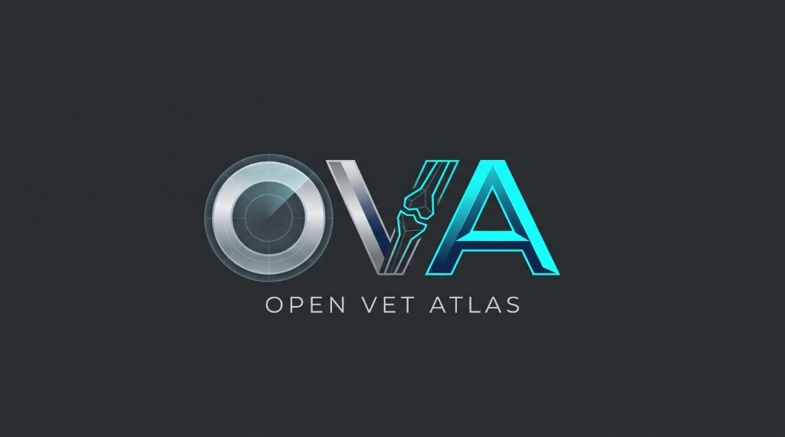

  

# OpenVetAtlas Android (oVa) — Official Wiki / Resmi Wiki

Welcome to the official documentation and developer wiki for **OpenVetAtlas Android (oVa)** — the open-source 3D Veterinary Anatomy & Osteology Platform for Android phones and tablets developed at **Aydın Adnan Menderes University (ADÜ), Faculty of Veterinary Medicine, Department of Veterinary Anatomy (DijiLab)** with the support of **ADÜ-BAP**.

**OpenVetAtlas Android (oVa)** resmi dokümantasyon sayfasına hoş geldiniz. Bu platform, **ADÜ-BAP** tarafından desteklenen ve **Aydın Adnan Menderes Üniversitesi Veteriner Fakültesi Anatomi Anabilim Dalı** bünyesinde kurulan **DijiLab** altyapısı kullanılarak geliştirilmiştir.

---

## 📚 Wiki Contents / Wiki İçindekiler

1. **[🏠 Home / Genel Bakış](Home)**
   * Project vision, supported Android hardware, anatomical roadmap, and dual-licensing model.
   * Proje vizyonu, desteklenen Android donanımlar, anatomik yol haritası ve çift lisans modeli.
2. **[📱 1. User Guide & Touch Controls / Kullanıcı Rehberi ve Kontroller](1-User-Guide-and-Touch-Controls)**
   * Touch orbit camera gestures, Taxon & Bone navigation, 3D Surface Spheres, click-to-focus auto-rotation, and Universal Latin Quiz Mode (`✔` / `×`).
   * Dokunmatik kamera hareketleri, Takson ve Kemik seçimi, 3B Yüzey Küreleri, listeden noktaya odaklama ve Evrensel Latince Quiz Modu (`✔` / `×`).
3. **[⚙️ 2. Architecture & Mobile Optimization / Yazılım Mimarisi ve Optimizasyon](2-Architecture-and-Optimization)**
   * 3-layer GDScript architecture, `gl_compatibility` (GLES3), `low_processor_usage_mode`, MatCap + Albedo hybrid shader, `QualityManager`, and Fit-to-Screen UI scaling.
   * 3 katmanlı GDScript mimarisi, `gl_compatibility`, pil dostu çizim, MatCap + Albedo hibrit shader, `QualityManager` ve Fit-to-Screen arayüz ölçekleme.
4. **[🦴 3. Adding New Bones & Blender Workflow / Yeni Kemik ve Pin Ekleme Rehberi](3-Adding-New-Bones-and-Blender-Workflow)**
   * How to register new species/specimens in `TAXON_CATALOG`, Blender `Node3D` landmark workflow, and `landmark_dictionary.json` canonical mapping.
   * `TAXON_CATALOG` ile yeni tür/kemik ekleme, Blender `Node3D` anatomik nokta iş akışı ve `landmark_dictionary.json` eşleştirme sistemi.
5. **[📦 4. APK Build & Android Installation / APK Derleme ve Cihaza Kurulum](4-APK-Build-and-Android-Installation)**
   * Headless verification (`verify_main_atlas.gd`), semantic-versioned APK export (`OpenVetAtlas_v0.4.0.apk`), and installing on Android phones/tablets.
   * Otomatik headless doğrulama, semantik versiyonlu APK üretimi ve Android telefon/tabletlere kurulum adımları.

---

## 🗺️ Anatomical Content Roadmap / Anatomik İçerik Yol Haritası

| Taxon (Takson) | System (Sistem) | Specimen (Piyes / Kemik) | Landmarks (Nokta) | Status (Durum) |
| :--- | :--- | :--- | :--- | :--- |
| **Canidae** (*Canis*) | *Systema Skeletale* | *Humerus, Scapula, Radius, Ulna* | 47 Pins / 46 Terms | ✅ **Active (v0.4.0-beta)** |
| **Equidae** (*Equus*) | *Systema Skeletale* | *Cranium* (with Albedo Texture) | 29 Pins / 26 Terms | ✅ **Active (v0.4.0-beta)** |
| **Canidae** (*Canis*) | *Systema Skeletale* | *Cranium, Ossa Membri Pelvini, Columna Vertebralis* | — | 📅 Planned |
| **Equidae** (*Equus*) | *Systema Skeletale* | *Ossa Membri Thoracici & Pelvini* | — | 📅 Planned |
| **Ruminantia** | *Systema Skeletale* | All Regions | — | 📅 Planned |

---

## 👥 Project Team / Proje Ekibi
* **Eren Özgürcan Yavaş**
* **Fatih Gürler**

*Institution / Kurum:* Aydın Adnan Menderes Üniversitesi, Veteriner Fakültesi, Anatomi Anabilim Dalı — **DijiLab**
